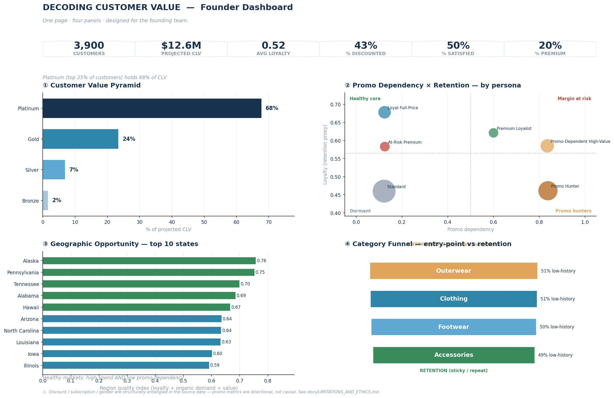

<div align="center">

# 📊 Decoding Customer Value
### A SQL-Driven Retention & Loyalty Intelligence Platform for a D2C Fashion Brand


*From raw transactions to a board-ready retention strategy — cleaning, feature
engineering, a rigorous loyalty framework, a full SQL analytics layer, an
interactive app, and consulting-grade recommendations, all reproducible with one
command.*

</div>

---

## 🎯 The brief

A D2C fashion brand needs to know **who its most valuable customers are, who is
loyal vs merely discount-dependent, and how to cut promotional reliance without
cutting sales.** The dataset has **no timestamps, no churn labels, and no loyalty
score** — so loyalty, value, and retention are **engineered from first
principles** and defended, not assumed.

## 💡 Headline findings (generated by the pipeline)

| Insight | Figure | So what |
|---|---|---|
| **Value is extremely concentrated** | Top **20%** of customers hold **~60%** of projected CLV (top decile alone = 38%) | A retention failure at the top dwarfs any acquisition win — protect them first. |
| **Discounting is largely habit, not stimulus** | **43%** of customers discounted; **~39%** of value is discount-attached | Most of that margin is recoverable with a sequenced sunset, not a blunt cut. |
| **A hidden retention emergency** | **233** "At-Risk Premium" customers: high value, **0% satisfied** | The single highest-ROI intervention — proactive CX saves, not discounts. |
| **A clear margin-risk cohort** | **~230** discount-dependent high-value customers ≈ **$2.1M** CLV | Migrate to behaviour-based loyalty *before* withdrawing price — never bluntly. |
| **Margin-aware loyalty wins** | Definition B beats A on revenue+margin alignment (0.69 vs 0.65 weighted) | The brand should measure *profitable* loyalty, not just activity. |

> Numbers are recomputed every run; see `reports/executive_summary.md` and
> `reports/loyalty_framework.md`. All figures carry documented data caveats.

## 🏗️ What's inside

```
clean ─► validate ─► profile ─► engineer 21 features ─► select loyalty (A/B)
      ─► segment (personas + KMeans) ─► SQL analytics layer ─► dashboards + recommendations
```

- **Robust cleaning + validation** — severity-tagged data-quality contract,
  category-median imputation, winsorisation, and detection of the dataset's
  structural quirks (discount≡promo collinearity; subscription/gender confounds).
- **21 engineered features** across Loyalty, Promotion, Value, Behavioural, and
  Geography families — each with a formula and a *why-leadership-cares* rationale
  ([glossary](docs/FEATURE_GLOSSARY.md)).
- **A loyalty A/B framework** — two competing definitions scored on revenue
  alignment, margin alignment, segment separation, robustness, and
  explainability, with a defended winner.
- **A full SQL analytics layer** — 19 documented views (segmentation, geography,
  product, revenue, executive) using CTEs and window functions, portable across
  SQLite and PostgreSQL.
- **An interactive Streamlit app** — executive cockpit, customer/segment
  explorers, geographic map, a **loyalty simulator** and a **promotional-sunset
  simulator**, and a live SQL viewer.
- **A Power BI deliverable** — DAX measures, theme, and a page-by-page wireframe
  with visual rationale.
- **Consulting-grade recommendations** — promotional sunset plan, ideal customer
  profile, growth strategy, and a candid risk analysis.

## 🚀 Quickstart

```bash
# 1. Install (core only needs pandas/numpy/pydantic/sklearn; this gets everything)
pip install -r requirements.txt          # or: pip install -e ".[all]"

# 2. Build everything from the raw CSV — one command, fully reproducible
python -m src.pipeline

# 3. Explore interactively
streamlit run src/dashboard/app.py

# 4. Run the tests
pytest -q
```
> Runs end-to-end with **zero infrastructure** — the SQL layer defaults to a
> local SQLite file. Set `DCV_DB_BACKEND=postgres` to target PostgreSQL instead.

## 🗂️ Repository structure

```
decoding-customer-value/
├── config/              # Pydantic settings + business thresholds
├── data/{raw,processed} # raw CSV in; clean data, feature table, SQLite DB out
├── notebooks/           # thin EDA notebook (calls src/, no spaghetti)
├── src/
│   ├── data_processing/ # clean, validate, profile, (optional pandera schema)
│   ├── feature_engineering/ # 5 feature families + registry + orchestrator
│   ├── business_logic/  # loyalty framework, segmentation, insights
│   ├── sql/             # schema, views, queries, runner, database manager
│   ├── dashboard/       # Streamlit app + pages + theme
│   └── pipeline.py      # one entrypoint orchestrating all stages
├── powerbi/             # DAX measures, theme.json, dashboard guide
├── reports/             # generated artefacts + hand-authored recommendations/
├── docs/                # architecture, data dictionary, glossary, SQL, deploy
├── tests/               # 28 tests (cleaning, features, loyalty, SQL)
├── scripts/             # glossary generator
└── .github/workflows/   # CI (lint + format + tests + pipeline smoke)
```

## 📈 Founder Dashboard (the four-panel board deliverable)



> _The mockup above is generated by `scripts/render_founder_dashboard_mockup.py`
> from the same SQL view exports the real Power BI dashboard consumes. To
> open the actual dashboard in **one click**, double-click
> [`powerbi/dashboard/DecodingCustomerValue.pbip`](powerbi/dashboard/DecodingCustomerValue.pbip)
> in Power BI Desktop — it ships a complete PBIP project (TMDL semantic model
> with 46 typed columns + 19 DAX measures, plus a 12-visual PBIR Founder page
> with KPI strip, slicers and the four panels). *File → Save As → `.pbix`*
> writes the binary. The full click-path with theme application is in
> [`powerbi/BUILD_PBIX_STEP_BY_STEP.md`](powerbi/BUILD_PBIX_STEP_BY_STEP.md);
> the layout spec is in
> [`powerbi/DASHBOARD_GUIDE.md`](powerbi/DASHBOARD_GUIDE.md). To regenerate
> the PBIP from the latest model, run `python scripts/build_pbip.py`. For the
> interactive analyst experience, `streamlit run src/dashboard/app.py`._

## 📑 The intelligence report (single read-through)
For reviewers who want the whole story without navigating folders, see
**[`reports/CUSTOMER_INTELLIGENCE_REPORT.md`](reports/CUSTOMER_INTELLIGENCE_REPORT.md)**
— auto-generated by the pipeline, ~3 pages, stitched from the per-domain
artefacts.

## 📚 Documentation

| Doc | What it covers |
|---|---|
| [Architecture](docs/ARCHITECTURE.md) | Layered design, flow diagram, extension points |
| [Technical README](docs/TECHNICAL_README.md) | Setup, module map, conventions |
| [Data Dictionary](docs/DATA_DICTIONARY.md) | Every raw & derived column |
| [Feature Glossary](docs/FEATURE_GLOSSARY.md) | All 21 features (auto-generated) |
| [SQL Documentation](docs/SQL_DOCUMENTATION.md) | Every view + techniques used |
| [Deployment Guide](docs/DEPLOYMENT.md) | Local, Docker, Streamlit Cloud, Postgres |
| [SQL Semantic Metrics](docs/SQL_METRICS.md) | The one definition of every grand total (powered by `v_metrics_base`) |
| [Power BI Guide](powerbi/DASHBOARD_GUIDE.md) | Wireframe + visual rationale + DAX |
| [Recommendations](reports/recommendations/) | Sunset plan · ICP · growth · risk |
| [Limitations & Ethics](docs/LIMITATIONS_AND_ETHICS.md) | What the data can and cannot support; targeting principles |
| [Interviewer Walkthrough](docs/INTERVIEWER_WALKTHROUGH.md) | 15-minute tour for technical reviewers |

## 🧠 Why this project stands out
- **Business logic first** — every metric has a documented rationale; nothing is
  vanity.
- **Honest about the data** — the structural confounds are surfaced, not hidden,
  and the recommendations account for them.
- **Reproducible & tested** — one command rebuilds everything; 28 tests + CI.
- **Production architecture** — config-driven, modular, logged, type-hinted,
  SQLite↔Postgres portable.

## 🔭 Future improvements
- Wire real transactional data (timestamps) to replace engineered tenure/CLV.
- Add an MLflow-tracked propensity model once labels exist.
- Materialized views + scheduled refresh on Postgres for larger data.
- Cohort retention curves once repeat-purchase timestamps are available.

## 📄 License
MIT — see [LICENSE](LICENSE).

<div align="center"><sub>Built as a flagship analytics-engineering + consulting portfolio project.</sub></div>
