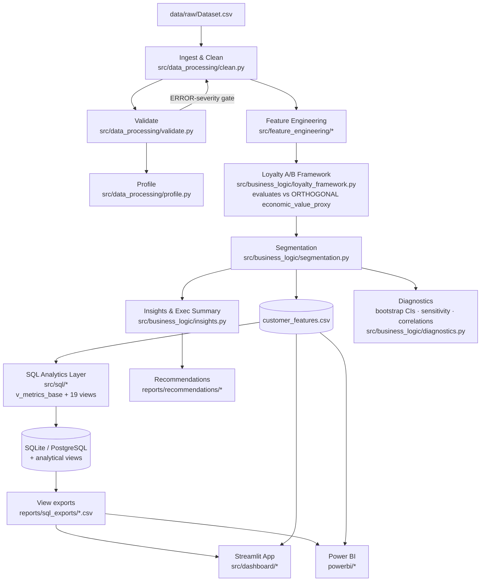

# Architecture

## 1. Design philosophy

The project is built as a **layered analytics-engineering pipeline**, not a
notebook. Each layer has a single responsibility, a stable interface to the next,
and is independently testable. The guiding constraints:

- **Reproducible by default** — one command (`python -m src.pipeline`) rebuilds
  every artefact from the raw CSV. No manual steps, no hidden state.
- **Runs anywhere** — the core pipeline depends only on the always-available
  stack (pandas/numpy/pydantic/sklearn + stdlib `sqlite3`). Postgres, Streamlit,
  Power BI, and Pandera are *optional capability upgrades*, not requirements.
- **Business logic is first-class** — thresholds and weights live in
  configuration and a feature registry, reviewable by analysts, not buried in
  code.
- **Docs cannot drift** — the feature glossary and validation/loyalty reports are
  generated from the same code that runs in production.

## 2. Layered flow



## 2a. The value decomposition (and why it matters)

```
annual_value           = purchase_amount * annual_purchase_freq          (loyalty-free)
margin_factor          = 1 - margin_haircut * discount_flag              (loyalty-free)
economic_value_proxy   = annual_value * margin_factor                    ← validation target
expected_tenure_years  = 1 + 4 * loyalty_score_v2                        (loyalty enters HERE)
estimated_clv_proxy    = economic_value_proxy * expected_tenure_years    ← forward composite
```

The loyalty framework validates the loyalty score against `economic_value_proxy`,
**not** against CLV. CLV mechanically contains loyalty (via the tenure term), so
using it as the validation target would be partly self-correlation. This split
is the most important analytical change in v2 of the project.

## 3. Layer responsibilities

| Layer | Module(s) | Responsibility | Key output |
|---|---|---|---|
| **Config** | `config/settings.py` | Type-safe settings, business thresholds, DB URL resolution | `Settings` singleton |
| **Utils** | `src/utils/` | Logging, the column contract (`schema.py`), I/O | — |
| **Ingest/Clean** | `src/data_processing/clean.py` | Dedupe, type-coerce, normalise, impute, winsorise | `customers_clean.csv` |
| **Validate** | `src/data_processing/validate.py` | Severity-tagged data-quality contract | `validation_report.{md,json}` |
| **Profile** | `src/data_processing/profile.py` | Distribution/cardinality/missingness summary | `profiling_summary.{md,json}` |
| **Features** | `src/feature_engineering/` | 21 engineered features across 5 families + registry | feature columns |
| **Loyalty** | `src/business_logic/loyalty_framework.py` | Score & select between two loyalty definitions | `loyalty_framework.{md,json}` |
| **Segment** | `src/business_logic/segmentation.py` | Rule-based personas + KMeans overlay | persona/cluster columns |
| **SQL** | `src/sql/` | Schema, views (segmentation/geo/product/revenue/exec), runner | `customer_value.db`, view CSVs |
| **Insights** | `src/business_logic/insights.py` | Headline metrics + caveats + exec summary | `executive_summary.md` |
| **Dashboard** | `src/dashboard/` | Interactive multi-page Streamlit app | live app |
| **Power BI** | `powerbi/` | DAX measures, theme, wireframe/visual rationale | board deliverable |

## 4. Why this structure (vs alternatives)

- **Why a feature registry?** It makes the 21 features auditable in one place,
  powers the auto-generated glossary, and lets a test assert code↔docs parity.
- **Why two loyalty definitions + a framework?** The brief demands rigour; a
  single "loyalty score" is an opinion. Scoring two against revenue, margin,
  separation, robustness, and explainability turns it into a defensible decision.
- **Why SQLite default with a Postgres switch?** Reproducibility for reviewers
  (zero setup) without sacrificing the production target. The `DatabaseManager`
  abstracts the engine; SQL is written to run on both.
- **Why Streamlit *and* Power BI?** Streamlit is the analyst's interactive tool
  (simulators, SQL viewer); Power BI is the executive/board artefact. Different
  audiences, deliberately.

## 5. Extension points
- **New feature:** add a function in the relevant `feature_engineering` module +
  an entry in `registry.py`; the glossary test enforces registration.
- **New SQL view:** drop a `.sql` file in `src/sql/views/`; the runner applies it
  automatically (lexical order) and can export it via `VIEW_EXPORTS`.
- **New threshold:** add to `BusinessThresholds` in `config/settings.py`; it is
  immediately overridable via a `DCV_THRESH_*` env var.
